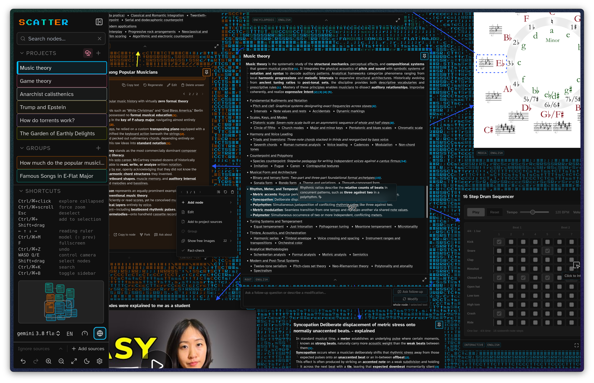

<h1 align="center">
  <a href="https://scatter.study">
    
  </a>
</h1>

<p align="center">Explore any topic with <strong>AI-powered mind maps</strong>.</p>

<p align="center"><strong>Free, private</strong> and (almost<a href="#license">*</a>) open source · Bring your own <strong>API keys</strong> · Supports <strong>cloud or local models</strong></p>

<picture>
  <source media="(prefers-color-scheme: dark)" srcset="assets/readme/hero-dark.png">
  <source media="(prefers-color-scheme: light)" srcset="assets/readme/hero-light.png">
  
</picture>

[Main capabilities](#main-capabilities) · [Get started](#get-started) · [Run locally](#run-locally) · [Privacy and data](#privacy-and-data) · [License](#license)

**Local-first, without an app backend.** Keys stay stored **on your device by default**. Requests go **directly to your model providers**; we do not hold your keys or collect your prompts, answers or canvas activity. Syncing keys is **opt-in**.

## Main capabilities

Keep the **main explanation in view** while you follow a term, ask another question or compare answers. Each branch stays connected on an **infinite canvas**.

- **Start with a topic, chat or image.**

  - Generate a **structured overview**, start a **conversation**, or upload or link an **image** to ask about it.
  - Add **your own sources** to the project.

- **Explore automatically marked terms.**

  - **Interesting or difficult terms** are marked automatically.
  - **Hover for an explanation; click to explore.** A click **creates a connected node** or takes you to one that already exists.

- **Ask follow-up questions about text and images.**

  - Questions can refer to a **whole node**, **selected text** or **selected image regions**.
  - Image-region questions create an **atlas-like mind map**, with an image node at the center.

- **Interactive nodes**

  - Generate an interactive node from a **prompt** or an **existing explanation**.
  - Run it **on the canvas** or in an **enlarged window**, then request changes through **follow-ups**.

- **Media on the canvas**

  - Place **images, GIFs and videos** alongside text and interactive nodes.
  - **Upload, paste, drop or link** images; add video files or **YouTube and Vimeo embeds**.

- **Layout and groups**

  - The **physics engine** spaces connected nodes apart.
  - Arrange nodes yourself and **pin** the ones you want to keep in place.
  - **Select several nodes** to move, pin, group or delete together.
  - Groups can contain **individual nodes, selections or whole branches**.
  - Assign colors manually or use **automatic hierarchical coloring** to distinguish parent groups from their descendants.

- **Your own sources**

  - Add **PDFs, documents, webpages, images or pasted text**.
  - Choose which sources to use and whether answers should **supplement them or stay within them**.
  - **Citations** let you inspect the referenced material.

- **Reading controls**

  - **Information chunking:** one core idea per sentence, one sentence per line and the **two or three most important parts** of each sentence in bold.
  - A **reading ruler** follows the text **line by line or word by word**.
  - The default font was chosen for **readability at small sizes**. Choose **OpenDyslexic or another font** in settings.

## Other functions

- Expandable **encyclopedic nodes**, focused explanations, chats and editable **Markdown text nodes**.
- **Chat branching**, file attachments, conversation history and the option to **turn an answer into a separate text node**.
- **Web search** through supported providers or a configured search service, with citation previews.
- **Fact-checking** for passages and individual chat answers, with findings and optional corrections.
- A visual and source **Markdown editor**: headings, nested lists, tasks, tables, code, mathematics, links and images. Export as **Markdown or Word**.
- **Image generation and editing**, including selected regions; cropping, adjustments and text or drawn annotations. Automatic or manual free-image search through **Wikimedia Commons and Openverse**, with attribution and license information.
- **Multiple projects**, search, automatic saving, import and export, **settings backups and earlier content versions**.
- **Synchronization** of projects and settings through Google Drive or WebDAV, including self-hosted Nextcloud, with cloud snapshot history.
- **Separate models for different tasks**, main-model switching, supported reasoning levels, **generation limits** and control over background activity.
- **Light and dark modes**, color controls, configurable shortcuts, **editable system prompts** and canvas layout settings.

## Get started

1. Open **[scatter.study](https://scatter.study)**.
2. Use **quick setup** for OpenRouter with recommended models, or **custom setup** to add providers and choose models yourself. **Change models or add providers** at any time.
3. **Set a spending limit** with your provider where supported. Use a **separate key for this app** if possible. Generation, term previews and other model-powered background tasks **can incur charges**.
4. Start with a **topic, chat or image**.

You can also **restore an existing setup** from a settings file or synchronization. Add **missing provider credentials** during restoration.

### Providers and models

Connect **OpenRouter, OpenAI or Anthropic**, or use **Ollama, LM Studio or an OpenAI-compatible endpoint**. **Gemini models are available through OpenRouter**; direct Gemini API connections are currently disabled because their terms are too restrictive for the app. Local servers must **allow browser connections from the app's address**.

| Role | Used for |
| --- | --- |
| **Main models** | **Explanations, conversations**, image questions and fact-checking. |
| **Secondary model** | **Term marking, previews, titles** and other background tasks. |
| **Interactive model** | Creating and modifying **interactive nodes**. |
| **Image model — optional** | **Generating images and editing** existing ones. |

**One model can serve several roles**. Unassigned secondary and interactive roles **fall back to the main model**. Without an image model, **AI image generation and editing are disabled**; viewing, cropping and annotating images remain available.

Features depend on the **selected model and provider**. **Local text models are supported**; local image generation is not currently supported. Web search for local models requires an **additional compatible search connection**.

## Privacy and data

Projects, sources, saved media and settings live **on your device in browser storage**. **No separate app account** is required. **There is no app backend or API relay:** we do not hold your keys, see your prompts and answers, or collect your canvas activity.

Your browser connects **directly to the services you use**:

- **Model providers** receive the API key and request content directly from your browser, never through our servers. Keys stay stored **on your device by default**. Requests can include **conversation history, source excerpts and images** needed for the task.
- **Optional sync** sends projects and settings to your Google Drive app-data folder or WebDAV server. Keys are excluded unless you enable **Sync model-provider API keys**; then they go to that service, not our servers.
- **Search and media services** receive requests for web search, free-image search and remotely hosted media. The app also makes a **content-free check** to Google's connectivity service. Each service's **data-handling policies** apply; using local models does not make every feature offline.

Settings exports are **created locally**. The standard export includes **provider keys and a configured WebDAV password** to restore your connections. Use **Export without keys or passwords** when sharing a configuration.

The app **does not add encryption** to local storage, settings exports or cloud snapshots. Keep **credential-containing backups private** and protect access to your device and sync account. **Export projects or enable sync** before clearing browser site data.

## Run locally

Use **Node.js 22.13 or later in the 22.x series, or Node.js 24.x**, with npm. The canvas needs a recent desktop browser, such as **Zen, Chrome, Firefox or Vivaldi**, with **WebGL2 and browser filesystem storage** enabled. Use **`localhost`** for local development and **HTTPS** for a hosted deployment.

From the **repository root**:

```bash
cd web
npm ci
npm run dev
```

Open **[localhost:3000](http://localhost:3000)** and complete onboarding. Enter model-provider keys **in the app** so they are stored in your browser, separate from the deployment.

The app uses **Next.js, React and TypeScript**, with a **WebGL ASCII canvas**, physics-based layout and browser-local persistence.

- <details>
  <summary><strong>Production build and Google Drive configuration</strong></summary>

  **`npm run build`** prepares an optimized build for deployment; **`npm start`** serves that build instead of the development server.

  Run from **`web/`**:

  ```bash
  npm run build
  npm start
  ```

  **Google Drive integration** on a custom origin (the website address, including its port) needs its own Google configuration. This lets Google recognize the address from which users **connect their Drive accounts**. See the **[deployment notes](web/README.md#optional-google-drive-synchronization)** and **[environment-variable template](web/.env.example)** for the required configuration.

  </details>

- <details>
  <summary><strong>Tests and browser checks</strong></summary>

  **Unit tests** check individual pieces of application logic. Run them from **`web/`**:

  ```bash
  npm test
  ```

  **Browser tests** exercise user interactions in a running app. Install the **Playwright browsers** once, then run both suites from **`web/`**:

  ```bash
  npx playwright install chromium firefox
  npm run e2e
  npm run test:interactive-browsers
  ```

  **`npm run e2e`** runs the general browser test suite. **`npm run test:interactive-browsers`** checks interactive content in Chromium and Firefox. Changes to embedded content need checks in **both engines**, including pointer input, focus, pause/resume and the enlarged viewer.

  </details>

- <details>
  <summary><strong>Credential checks before committing and pushing</strong></summary>

  Running **`npm ci` in `web/`** installs Git hooks: automatic checks that run before commits and pushes. To install them separately, run **`node scripts/install-git-hooks.mjs`** from the repository root.

  - **Commit checks** inspect staged files, the changes selected for the next commit.
  - **Push checks** inspect the complete outgoing history so an old branch cannot silently restore removed credentials.
  - **GitHub Actions** repeats the history scan after pushes and on pull requests.
  - Installed hooks stay in **Git metadata**, so they remain active when checking out an older branch.

  Keep API keys **in the app or ignored local credential files**. Do not commit **full settings exports, project exports, network captures or real keys in tests**. Scanner reports contain file names and line numbers, **never matched values**. The exact **public Google Picker browser key** is the sole documented fingerprint exception.

  **These checks reduce accidental exposure**, but hooks can be bypassed and Actions runs after upload. They do not replace **revoking a leaked credential**.

  </details>

## Limitations and reporting issues

AI answers, citations, generated images and fact-check results **can be wrong**. Source restrictions and verification tools assist review; they **do not guarantee accuracy**.

When reporting a problem, include **reproduction steps, your browser and the relevant provider and model**. **Remove API keys, private source material and sensitive project data** from screenshots and exports.

## License

The app's original code uses the **[PolyForm Noncommercial License 1.0.0](LICENSE.md)**. It permits **use, modification and redistribution** for the purposes defined in the license. Commercial uses outside those permissions require **separate permission** from the relevant copyright holders.

The “**almost**” in the introduction matters: this is **source-available, not open source under the [Open Source Definition](https://opensource.org/osd)**. Third-party components and assets retain **their own licenses**.
