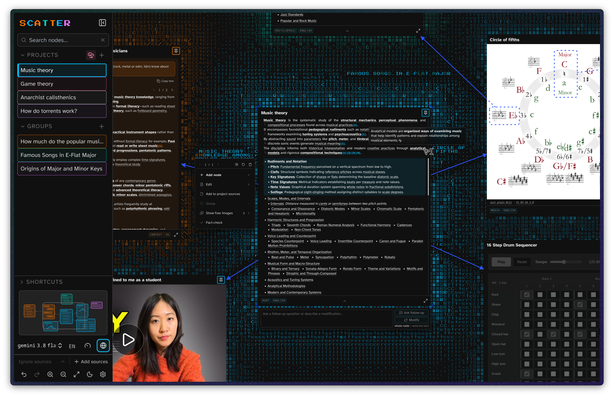

<h1 align="center">
  <a href="https://www.scatter.study/app">
    
  </a>
</h1>

<p align="center">Explore any topic with <strong>AI-powered mind maps</strong>.</p>

Generate a **structured overview**, follow **marked terms** into **connected explanations** and keep every branch on an **infinite canvas**. Built to keep **model usage costs low**.

**Free** and **[source-available](#license)**. Bring **your own API keys** for **cloud** or **local models**. Projects **stay in your browser**.

<picture>
  <source media="(prefers-color-scheme: dark)" srcset="assets/readme/hero-dark.png">
  <source media="(prefers-color-scheme: light)" srcset="assets/readme/hero-light.png">
  
</picture>

**[Open the app](https://www.scatter.study/app)** · **[Try the interactive demo](https://www.scatter.study/?landing=1#demo)**

The demo replays **recorded answers** for this project. Click a **marked term** to open it, or type in a **follow-up field or the chat** to ask a prepared question. **Nothing is sent to a model provider**; reload the page to reset the demo. On touch screens, **tap** a term to open it or **hold** it for its preview.

[Main capabilities](#main-capabilities) · [Model costs](#what-keeps-model-costs-down) · [Privacy](#privacy-and-data) · [Get started](#get-started) · [Run locally](#run-locally) · [Support me](#support-me)

## Main capabilities

**Keep the main explanation in view.** Follow a term, ask another question or compare answers. Each branch **stays connected** to the node it came from.

- **Start with a topic, a chat or an image.**
  - Generate a **structured overview** of a topic, start a **conversation**, or upload or link an **image** to ask about it.
  - Add **your own sources** to the project at any point.
- **Hover for an explanation, click to explore.**
  - The app **marks terms worth exploring** in generated answers. In encyclopedic nodes, **expandable bullets suggest directions** for further exploration.
  - Hovering a term shows a **short explanation**. Clicking it **creates a connected node**, or takes you to the node that already covers it.
- **Add images, GIFs and videos.**
  - **Upload, paste, drop or link** images and GIFs. Add **video files** or **YouTube and Vimeo embeds**.
  - Media nodes sit in the map **alongside text and interactive nodes**.
- **Ask about a node, a passage or part of an image.**
  - Follow-up questions can refer to a **whole node**, **selected text** or **selected image regions**.
  - Questions about image regions build an **atlas-like map** with the image node at the center.
- **Run interactive nodes on the canvas.**
  - Generate an interactive node from a **prompt** or from an **existing explanation**. Run it **on the canvas** or in an **enlarged window**.
  - **Request a change** to the program, or **ask a follow-up question** without modifying it.
- **Arrange branches and groups.**
  - A **physics engine** spaces connected nodes apart, and **pinned nodes** stay where you put them.
  - **Select several nodes** to move, pin, group or delete them **together**. Groups hold single nodes, selections or whole branches, with manual or **automatic hierarchical colors**.
- **Answer from your own sources.**
  - Add **PDFs, documents, webpages, images or pasted text**. Restrict answers to **your selected sources only**, or combine them with **the model’s knowledge** and, when enabled, **web search**.
  - **Citations** let you inspect the referenced material.
- **Easy to read and understand.**
  - **Information chunking** gives each sentence **one core idea** on **its own line**. Key parts are **bolded** or **marked as terms**.
  - A **reading ruler** follows the text **line by line** or **word by word**.
  - The default font stays **legible at small sizes**; **OpenDyslexic and other fonts** are available in settings. If the ASCII background is distracting, **lower its opacity** in Appearance settings.

## Also in the app

- **Node types:** Expandable **encyclopedic nodes**, focused **explanations**, **chats**, editable **Markdown text nodes**, **media nodes** and **interactive nodes**.
- **Chats:** **Branching**, **file attachments**, conversation history, fact-checking individual answers and copying an answer to a **separate text node**.
- **Web search:** Search through **supported providers** or a **configured search service**, with citation previews.
- **Fact-checking:** Check text **sentence by sentence**. Review cited evidence where available, see which claims lack support, and **rewrite the text using the evidence**.
- **Markdown editor:** **Visual and source editing** with tables, tasks, code, mathematics and images. **Export as Markdown or Word**.
- **Image generation and editing:** Generate images or use AI to edit **the whole image or a selected region**. Crop, adjust, draw or **annotate with text** manually.
- **Free images:** Automatic or manual search through **Wikimedia Commons and Openverse**, with **attribution and license information**.
- **Projects:** Search, **automatic saving**, import and export, settings backups and **earlier content versions**.
- **Synchronization:** Projects and settings sync through **Google Drive or WebDAV**, including self-hosted Nextcloud, with **snapshot history**.
- **Multiple AI models:** Switch between **several main models** on the canvas. Assign other models by task and control **reasoning, token limits and background activity**.
- **Deep customization:** Adjust **appearance** with colors, fonts and canvas effects. Change **behavior** with keyboard shortcuts, reading controls and layout settings.

## What keeps model costs down

Your **model choices and provider rates** determine the bill. The recommended models balance **answer quality, speed and price**.

- **Use a knowledgeable main model.** Prioritize factual knowledge and a low rate of invented answers. Ordinary branches generate **text rather than code** and send at most the **parent and grandparent** as canvas history—not the whole project.
- **Keep routine work inexpensive.** A **separate, cheaper secondary model** marks terms, writes previews and generates titles. Repeated background tasks need not run at the main model’s rate.
- **Limit reasoning by default.** Main and secondary tasks default to **low reasoning** where the model supports it. This limits the tokens and time spent thinking; you can raise the main model’s effort when a question warrants it.

### Necessary exceptions

- **Interactive nodes:** The coding model **writes, tests and revises** a working program. Passing code and test results between steps uses more tokens than a text answer, but gives the model a chance to **catch and fix mistakes** before you use the node.
- **Image generation:** For educational images, we recommend a **higher-quality model**, even if it costs more. Look for one that draws **labels, proportions and relationships** accurately instead of inventing details. Even a convincing image can be wrong; **check important details against a source**.

## Privacy and data

**Your projects stay off our servers.** Projects, sources, saved media and settings are stored **in your browser**. **No separate app account** is required. Your browser sends requests **directly to your model providers**; **no app server or API relay** sits in between.

API keys stay **on your device** by default. Syncing them is **opt-in**. We **do not receive or store your projects, prompts, answers or API keys** on an app server.

| Your browser connects directly to | Services |
| --- | --- |
| **Model providers** | OpenRouter, OpenAI, Anthropic, or a local server such as Ollama |
| **Optional sync** | Google Drive app-data folder or a WebDAV server |
| **Search and media** | Web search, Wikimedia Commons, Openverse, embedded videos |

[Read the privacy notice](https://www.scatter.study/privacy).

## Get started

Connect a **model provider** or a **model server running on your computer**. With OpenRouter quick setup, you **don’t need an API key in advance**.

1. [Open the app](https://www.scatter.study/app) in a **desktop browser**.
2. Use **quick setup** for OpenRouter with recommended models, or **custom setup** to add providers and choose models yourself.
3. **Set a spending limit** with your provider where supported, and use a **separate key** for this app if possible.
4. Start with a **topic, a chat or an image**.

Generation, term previews and other background tasks **can incur charges** with your provider. AI answers, citations, generated images and fact-check results **can be wrong**.

### Providers and models

Connect **OpenRouter, OpenAI or Anthropic**, or use **Ollama, LM Studio** or an OpenAI-compatible endpoint. Gemini models are available **through OpenRouter**. Local servers must **allow browser connections** from the app’s address.

| Role | Used for |
| --- | --- |
| **Main models** | Explanations, conversations, image questions and fact-checking |
| **Secondary model** | Term marking, previews, titles and other background tasks |
| **Interactive model** | Creating and modifying interactive nodes |
| **Image model, optional** | Generating and editing images |

**One model can serve several roles**. Unassigned secondary and interactive roles **fall back to the main model**.

## Run locally

Use **Node.js 22.13 or later in the 22.x series, or Node.js 24.x**, with npm. The canvas needs a recent desktop browser, such as **Zen, Chrome, Firefox or Vivaldi**, with **WebGL2 and browser filesystem storage** enabled. Use **`localhost`** for local development and **HTTPS** for a hosted deployment.

From the **repository root**:

```bash
cd web
npm ci
npm run dev
```

Open **[localhost:3000](http://localhost:3000)** and complete onboarding. Enter model-provider keys **in the app** so they are stored in your browser, separate from the deployment.

The app uses **Next.js 16, React 19 and TypeScript**, with a **WebGL ASCII canvas**, physics-based layout and browser-local persistence. The development and production scripts use **webpack** to preserve the browser-only model-runtime configuration.

- <details>
  <summary><strong>Production build and Google Drive configuration</strong></summary>

  **`npm run build`** prepares an optimized build for deployment; **`npm start`** serves that build instead of the development server.

  Run from **`web/`**:

  ```bash
  npm run build
  npm start
  ```

  **Google Drive integration** on a custom origin (the website address, including its port) needs its own Google configuration. This lets Google recognize the address from which users **connect their Drive accounts**. See the **[deployment notes](web/README.md#optional-google-drive-synchronization)** and **[environment-variable template](web/.env.example)** for the required configuration.

  </details>

- <details>
  <summary><strong>Tests and browser checks</strong></summary>

  **Type checks and unit tests** check application types and logic. Run them from **`web/`**:

  ```bash
  npm run typecheck
  npm test
  ```

  **Browser tests** exercise user interactions in a running app. Install the **Playwright browsers** once, then run both suites from **`web/`**:

  ```bash
  npx playwright install chromium firefox
  npm run e2e
  npm run test:interactive-browsers
  ```

  **`npm run e2e`** runs the general browser test suite. **`npm run test:interactive-browsers`** checks interactive content in Chromium and Firefox. Changes to embedded content need checks in **both engines**, including pointer input, focus, pause/resume and the enlarged viewer.

  </details>

- <details>
  <summary><strong>Credential checks before committing and pushing</strong></summary>

  Running **`npm ci` in `web/`** installs Git hooks: automatic checks that run before commits and pushes. To install them separately, run **`node scripts/install-git-hooks.mjs`** from the repository root.

  - **Commit checks** inspect staged files, the changes selected for the next commit.
  - **Push checks** inspect the complete outgoing history so an old branch cannot silently restore removed credentials.
  - **GitHub Actions** repeats the history scan after pushes and on pull requests.
  - Installed hooks stay in **Git metadata**, so they remain active when checking out an older branch.

  Keep API keys **in the app or ignored local credential files**. Do not commit **full settings exports, project exports, network captures or real keys in tests**. Scanner reports contain file names and line numbers, **never matched values**. The exact **public Google Picker browser key** is the sole documented fingerprint exception.

  **These checks reduce accidental exposure**, but hooks can be bypassed and Actions runs after upload. They do not replace **revoking a leaked credential**.

  </details>

## License

The app’s original code is published under the **[PolyForm Noncommercial License 1.0.0](LICENSE.md)**. It **permits use, modification and redistribution** for the purposes the license defines; **commercial uses** outside those permissions **need separate permission**.

This makes the app **source-available, not open source** under the [Open Source Definition](https://opensource.org/osd). Third-party components and assets **keep their own licenses**.

## Support me

I’m **Jakub Fleites-Jonczyk**. I’m originally from **Poland** and now live in **Germany**, where I’m in my fifth year of **psychiatry residency**. In my spare time, I build web apps and other things. I have **ADHD** and built this app so I could **study** in a way that works for me.

My **residency** takes up most of my week. If you find the app **useful**, **supporting me on Ko-fi** would help me set aside more time to work on it.

[](https://ko-fi.com/G2G4104TZU)

## Contact me

For **questions or bug reports**, email [scatter.study@gmail.com](mailto:scatter.study@gmail.com) or open a [GitHub issue](https://github.com/ctrlaltjakub/scatter/issues).
